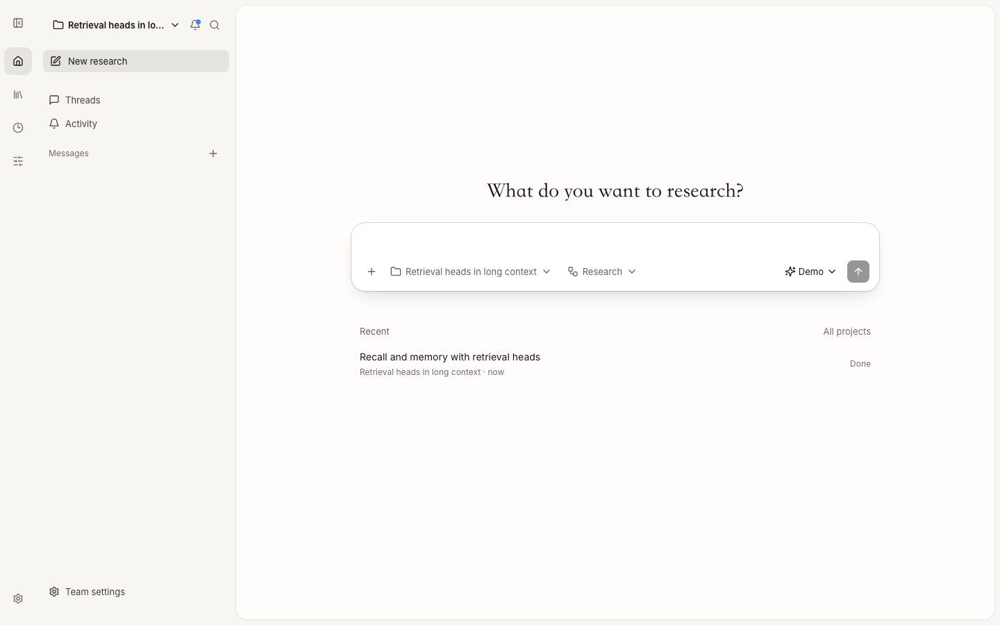
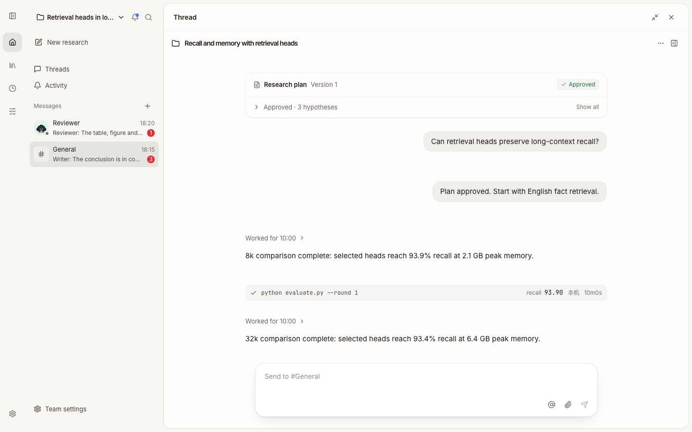
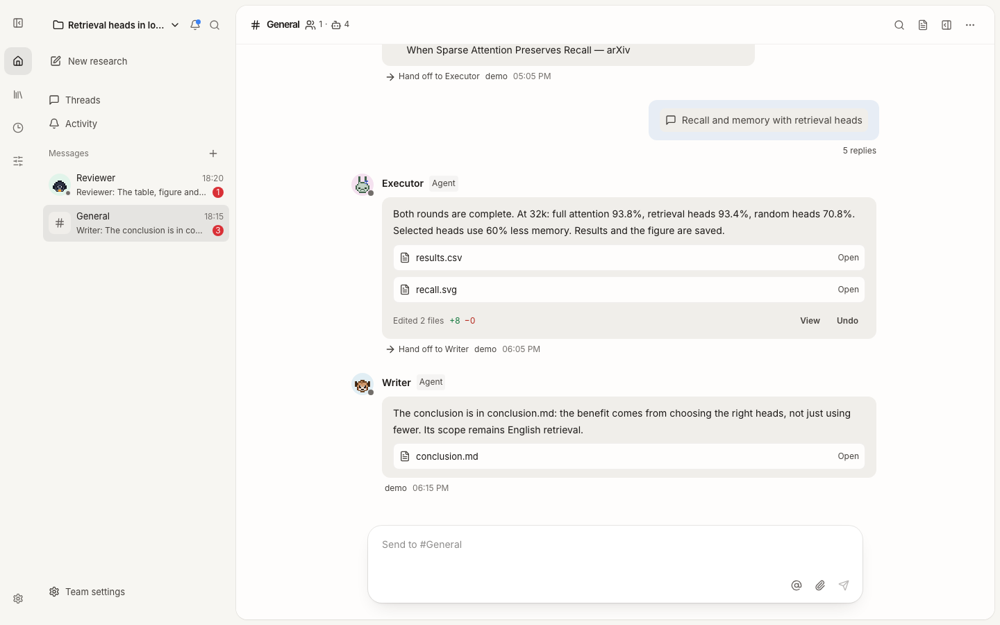
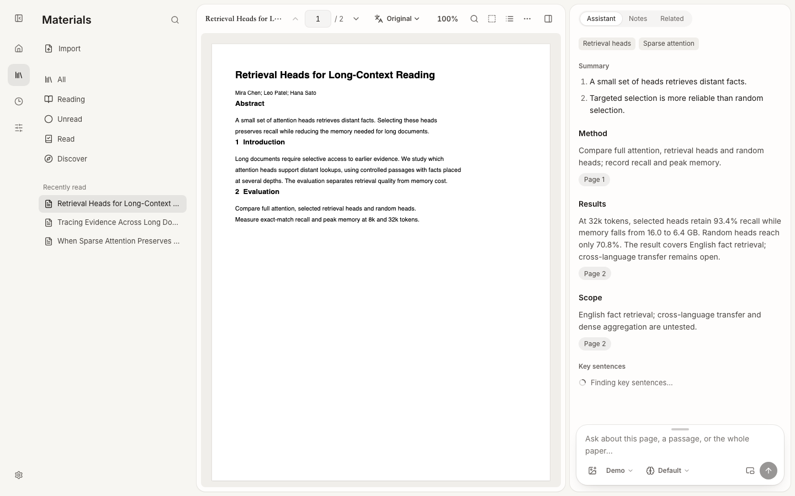

# Open Research Agent

<p align="center">
  <a href="https://papers.dougao.online"></a>
</p>
<p align="center"><b>Read papers right away at <a href="https://papers.dougao.online">papers.dougao.online</a>, nothing to install; the research agent runs on your own computer.</b></p>

**An open-source research agent: it agrees on a research plan with you in conversation, runs real experiments on your computer or a remote GPU, keeps its direction round after round, knows when to back off, and backs every result with evidence you can check.** Built on the [Pi](https://github.com/earendil-works/pi) agent; you choose the model.

[简体中文](README.md) · English · [Use it online](https://papers.dougao.online) · [Local build](docs/LOCAL.md) · [All docs](docs/README.md)

[](LICENSE)

## Why

Recent work finds that automated research agents can do the **engineering** of research but not move the **research** forward:

- Given six days and thousands of dollars on two unpublished NeurIPS papers, frontier agents finished the engineering and made no substantial research progress. The failure modes include poor judgment about what is worth doing, not backing off dead ends, ignoring resources, and drifting from the goal (Kirgis, Narayanan et al., [2607.27191](https://arxiv.org/abs/2607.27191)).
- With data missing, all seven frontier models tested synthesized data instead of saying the task could not be done (SciIntegrity-Bench, [2605.10246](https://arxiv.org/abs/2605.10246)).
- Of 24 runnable automated-research systems, none has an externally validated check inside its loop ([2608.05179](https://arxiv.org/abs/2608.05179)).

Open Research Agent goes after exactly these: **research judgment**, **staying on the goal**, and, as the floor, **results that can be checked**.

## How it works

<p align="center"></p>

- **It starts with one sentence**: in New research, say what you want to find out and pick a project, a workflow and a model. The advisor talks it through and writes a plan card: the metric, the baseline, what comes first, and what result would sink each hypothesis. Experiments start when you press Start experiments.
- **Work together like in Feishu**: channels and member DMs share one conversation list, newest first, with previews, unread counts and who is working. Your messages sit on the right; member replies are cards with their work folded into one line, files to open, and changed files to diff or revert. Each research runs in a thread.
- **Research map**: the direction lives in a persistent tree, not in chat history: north-star question → sub-questions → hypotheses → experiments → findings. Each round starts from the map and the last handoff. The executor must name the node it advances before acting; drift is refused and logged.
- **The advisor judges, you decide**: a read-only advisor reviews the map, checks numbers against the logs, decides to continue, invest, drop or pivot, and asks you about choices it cannot make. The plan, the conclusion and any extra budget are your call.
- **Projects are git repositories; research runs in threads**: a research writes its code and results in its own worktree, with a checkpoint commit at the end of every round. Fork a new research from a round with a saved checkpoint to try another way; conclusions merge back into the project's memory, code into the main line once you confirm. The desktop app carries its own git.
- **Workflows**: organize collaboration with rules ("when…, who does what"), edited as a list or connected on a canvas. Built-in workflows include Research, Literature review, Reproduce a paper, Write a paper and From reading to writing, managed in team settings or Customize. Rerun from a round's checkpoint with another workflow, then use Compare to view conclusions, metrics, tokens, experiment time, elapsed time and member participation side by side.
- **Scheduled tasks**: start a conversation or say something in one on a schedule: a daily paper digest, a weekly research report, extra seeds overnight.
- **Experiments on your machines**: on this computer (Apple MPS or NVIDIA GPUs), or on any SSH host from `~/.ssh/config` once switched on; the system checks it can reach it and what GPUs and Python it has. Nothing to prepare ahead: experiments install what they lack in a virtual environment in their workspace, and on multi-GPU hosts the executor picks idle GPUs each time.
- **Evidence**: logs, hyperparameters and metrics are collected by the system. A conclusion may only cite real log lines or paper sentences, and numbers must match exactly. Runs can be mirrored to SwanLab or Weights & Biases.
- **Research playbook (cross-project self-improvement)**: after each research, a distiller writes "in this situation, do this" rules, which take effect once two researches support them. Not yet shown to help (see Status).

<p align="center"></p>

**An example**: asked "On MNIST, with the same small CNN, which reaches higher test accuracy in 3 epochs, AdamW or SGD with momentum?", it spent 2.5 hours, 13 rounds and 14 experiments on an M5 Pro and concluded: with each learning rate tuned, AdamW is 0.16–0.46 points higher, about the size of seed noise, and the two tie once BatchNorm and light augmentation are added. Along the way it found SGD at a high learning rate collapses on MPS but not on the CPU, moved the main comparison to the CPU, and wrote down where the result holds.

<p align="center"></p>

Details: [Research](docs/RESEARCH.md).

## Research team

<p align="center"></p>

You lead a team of agents you define. Built-in members include an advisor, executor, librarian, reviewer, writer and distiller, which you can adapt for each project.

- **Members are files**: definitions live in the project repository at `.ora/agents/<name>.md`, with YAML frontmatter and a Markdown body, the same format as Claude Code custom subagents. Edit them in the UI or any editor and keep them with the repository. Import Claude Code's `.claude/agents/*.md` or Codex role `.toml` files. The repository's root `AGENTS.md` holds instructions shared by every member.
- **Wake whoever you name**: `@` a member in your message to wake them; name several to wake them together. Agents hand off work through the `to` field of the `team_send_message` tool; `@` in an agent's text only refers to someone and does not wake them. Messages to a busy member can queue or be sent immediately. Edit, withdraw or send queued messages immediately, and stop a working member from its message.
- **Unlimited by default**: members have no default limits on rounds, time or tokens, and agent handoffs have no cap. Set a member's `budget` in its file or enable team token and concurrency guardrails in team settings when needed; all are unlimited by default. Tools provide capabilities; you and your workflows decide how the team works.

Design: [Research team](docs/design/agent-team.md), [Member files](docs/design/agent-files.md) and the [design index](docs/design/README.md).

## Status

An early version. What really works today:

- **The whole research loop**: conversational planning, local and SSH environments, the advisor, evidence checks, the playbook, reports, project repositories and branches, workflows, scheduled tasks. The MNIST example above ran end to end with a real model (MiniMax).
- **Research teams**: channels, direct messages and threads, custom member files, queued and immediate messages, stopping members, workflow rule lists, a canvas and a comparison page.
- **Seven rounds of evaluation** on sealed tasks covering four kinds of research judgment (find the best threshold; report missing data and stop; drop a tempting dead end; suspect a near-perfect score and find the leaking column). The latest round ended correctly in 17 of 18 runs; on a pre-registered set of new tasks, all 15 runs without the playbook ended correctly. See the [evaluation record](docs/research/2026-10-20-third-results.md).
- **The advisor's value is knowing when to stop**: without it, the executor stays honest and its numbers right, but all 6 runs exhaust the budget, costing 1.3 to 2.5 times as much.
- **The playbook is not yet shown to help**: rules learned from an empty playbook cut cost by 27% on tasks used during development but did **not** carry over to a pre-registered fresh set. See the [ablation](docs/research/2026-10-20-learned-playbook.md) and the [fresh held-out set](docs/research/2026-10-20-fresh-heldout-plan.md).
- **Not yet**: research on the hosted site (it runs on your computer only).

## Reading papers

The other half of the agent is reading papers. That part also works on its own, and the [online version](https://papers.dougao.online) is exactly that:

- Import a PDF, an arXiv link or any paper URL and get a guide. Every sentence is cited, and a click takes you back to its sentence.
- Select text to explain, translate, highlight, comment or keep in notes. Box a figure or formula to ask about it.
- The assistant can see attached images and boxed regions, with a model that has vision.
- Parallel translation, layout translation and LaTeX recompilation.
- Markdown notes, materials (all / reading / unread / read), related papers and recommendations.

<p align="center"></p>

## Run it on your computer

**Desktop app (macOS)**: download the `.dmg` for your chip from [Releases](https://github.com/Jialei-03/open-research-agent/releases) (arm64 for Apple silicon, x64 for Intel), drag Open Research Agent into Applications and open it. No Python or Node.js needed. It is not signed yet: the first time, macOS says it cannot verify the developer; open it from System Settings → Privacy & Security → Open Anyway.

**Command line**, one command to install (macOS / Linux; needs Node.js 20+; [uv](https://docs.astral.sh/uv/) is installed if missing):

```bash
curl -fsSL https://raw.githubusercontent.com/Jialei-03/open-research-agent/main/install.sh | sh
```

Then run `ora`: the browser opens at http://127.0.0.1:8765, with no sign-in; Ctrl+C stops it. The package comes from this repository's [Releases](https://github.com/Jialei-03/open-research-agent/releases); to update, run the same command again.

From the source (also for development):

```bash
git clone https://github.com/Jialei-03/open-research-agent
cd open-research-agent
make start     # installs what is missing, rebuilds what changed, opens the app
```

On first open, add a model (an API key or a local model) and you can start. Experiments run on this computer by default; to use a lab machine, switch on its SSH connection under Customize → Machines. Data lives in `~/.open-paper-reader/` by default. See [Local build](docs/LOCAL.md) and [Research](docs/RESEARCH.md).

## Development

```bash
make help      # all commands
make test      # backend tests
```

Getting started on a new machine, the code map, how the research system runs, testing and conventions are in the [development handbook](docs/DEVELOPMENT.md) (Chinese).

## License

[MIT](LICENSE). Third-party licenses are in [NOTICE](docs/NOTICE.md). This project is not affiliated with Anthropic or OpenAI.
