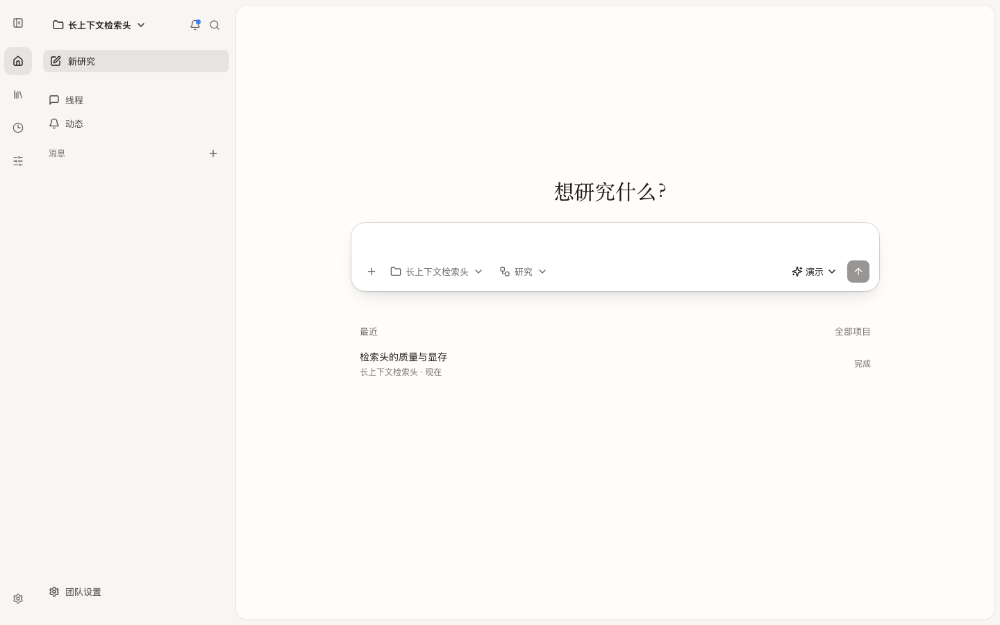
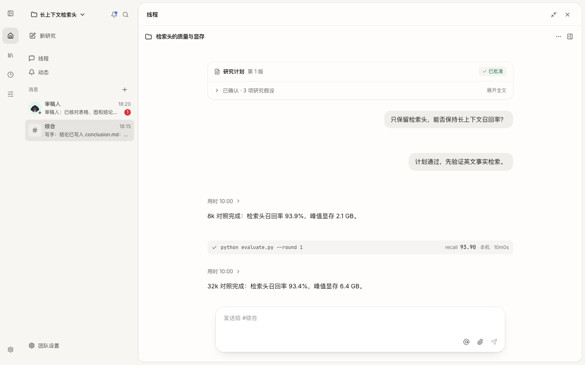
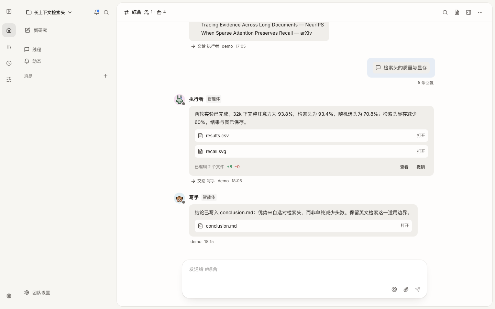
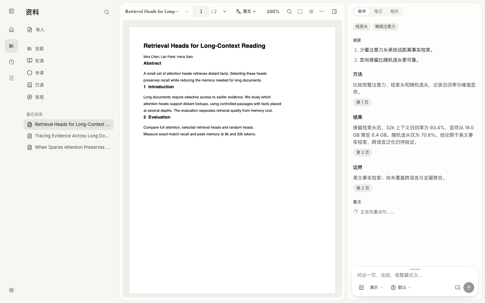

# Open Research Agent

<p align="center">
  <a href="https://papers.dougao.online"></a>
</p>
<p align="center"><b>在线版 <a href="https://papers.dougao.online">papers.dougao.online</a> 可以直接读论文，不用安装；研究 Agent 在你自己的电脑上运行。</b></p>

**开源的研究 Agent：和你对话定下研究计划，在你的电脑或远程 GPU 上做真实实验，守住方向、一轮一轮推进，知道什么时候该回头，并且每个结论都有据可查。** 底层基于 [Pi](https://github.com/earendil-works/pi) Agent，模型由你自己选。

简体中文 · [English](README.en.md) · [在线使用](https://papers.dougao.online) · [本机版](docs/LOCAL.md) · [全部文档](docs/README.md)

[](LICENSE)

## 为什么做这个

最近的研究发现，自动科研 Agent 已经能完成科研的**工程**部分，却推进不了**研究**本身：

- 前沿 Agent 用 6 天、几千美元重做两篇未发表的 NeurIPS 论文，工程都做完了，研究没有实质进展。归纳出的失败包括：不知道什么值得做、走进死胡同不回头、不顾资源、做着做着偏离目标（Kirgis, Narayanan 等，[2607.27191](https://arxiv.org/abs/2607.27191)）。
- 缺数据时，7 个前沿模型全部选择自己合成数据，而不是承认做不了（SciIntegrity-Bench，[2605.10246](https://arxiv.org/abs/2605.10246)）。
- 在 24 个可运行的自动科研系统里，没有一个在流程内有经过外部验证的核验机制（[2608.05179](https://arxiv.org/abs/2608.05179)）。

Open Research Agent 主攻的就是这些：**研究判断力**、**持续不偏离目标**，以及作为底线的**结论可核验**。

## 它怎么工作

<p align="center"></p>

- **从一句话开始**：在「新研究」里说你想弄清楚什么，选好项目、工作流和模型。导师和你聊几句，写出一张计划卡片：指标、基线、先做什么、每个假设什么结果算失败（止损条件）。你点「开始实验」，实验才开始。
- **像飞书一样协作**：频道和成员私信在一个会话列表里，按最近活动排序，有预览、未读和「工作中」。你的消息在右，成员的回复是卡片：工作过程折叠成一行，产出的文件可直接打开，改过的文件可以查看 diff 或撤销。一项研究在线程里推进。
- **研究地图**：研究方向不放在聊天记录里，而是放在一张持久的树上：北极星问题 → 子问题 → 假设 → 实验 → 发现。每一轮从地图和上一轮的交接开始，可以跨很多轮、跨天地做下去。执行者动手前必须声明在推进哪个节点，偏离会被拒绝并记录。
- **导师判断，你来拍板**：只读的导师审视地图、按日志核对数字，决定继续、加注、放弃还是转向，拿不准的口径会问你。计划、结论、追加预算由你决定。
- **项目就是 git 仓库，研究是线程**：研究在自己的 worktree 里写代码和结果，每一轮结束自动提交一次检查点。可以从已有检查点的轮次分叉出新的研究换条路试；结论合并回项目记忆，代码经你确认后合并进主线。桌面版自带 git。
- **工作流**：用「当……时，谁做什么」的规则组织协作，同一套规则可以按列表编辑，也可以在画布上连线。内置「研究」「文献综述」「复现一篇论文」「写论文」「从读到写」，在团队设置或「自定义」里管理。可以从轮次检查点换个工作流再做一遍，在「比较」页并排查看结论、指标、token、实验用时、总用时和成员参与。
- **定时任务**：按时在项目里开新对话或给已有对话发话，比如每日论文速递、每周研究周报、夜里补跑种子。
- **在你的机器上跑实验**：本机直接跑（Apple 芯片的 MPS 或 NVIDIA GPU），或者打开 `~/.ssh/config` 里任何一台 SSH 机器的开关，系统检测能不能连上、有什么 GPU 和 Python。不用事先准备环境：缺包时实验在自己的工作区里建虚拟环境安装；多卡机器上执行者每次挑空闲的卡。
- **证据**：实验的日志、超参和指标由系统采集，不靠 Agent 自己抄。结论只能引用真实的日志行或论文原句，数字必须逐字对得上。可以同步到 SwanLab 或 Weights & Biases。
- **研究手册（跨项目自我改进）**：每个研究结束后，提炼者把经过写成「在什么情况下该怎么做」的判断规则，被两个研究支持后才生效，之后的研究都会读到。目前还没有证明它有效（见下面的现状）。

<p align="center"></p>

**一个例子**：问「在 MNIST 上，同一个小 CNN，AdamW 和带动量的 SGD 哪个在 3 个 epoch 内测试准确率更高？」。它在一台 M5 Pro 上用 2.5 小时、13 轮、14 个实验给出的结论是：各自调好学习率后 AdamW 高 0.16–0.46 个百分点，但和种子噪声同一量级，加上 BatchNorm 和轻度增强后打平；顺带发现 MPS 上高学习率的 SGD 会崩溃而 CPU 上不会，于是把主对照改到 CPU 上做，并把适用范围写清楚。

<p align="center"></p>

详细说明见 [研究](docs/RESEARCH.md)。

## 研究团队

<p align="center"></p>

你是负责人，团队成员是你自定义的 agent。内置导师、执行者、文献员、评审、写手、提炼者，可以按项目修改。

- **成员就是文件**：定义放在项目仓库的 `.ora/agents/<name>.md`，YAML 头 + Markdown 正文，与 Claude Code 自定义 subagent 同格式；可以在界面或编辑器里改，随仓库保存。支持导入 Claude Code 的 `.claude/agents/*.md` 和 Codex 的角色 `.toml`。仓库根目录的 `AGENTS.md` 是全体成员共享的说明。
- **叫谁，谁来做**：你在消息里 `@` 谁就叫醒谁，一次可以叫多个。agent 之间交接，用消息工具 `team_send_message` 的 `to` 指定接手成员；agent 正文里的 `@` 只表示提到，不会叫醒对方。发给正在工作的成员时，可以排队，也可以立即发送；排队消息可以编辑、撤回或改成立即发送，正在做的成员可以在它的消息上停止。
- **默认不限**：成员默认没有轮数、时长或 token 预算上限，agent 之间的接力也没有上限。需要时可以在成员文件的 `budget` 中设置预算，或在团队设置里启用 token、并发成员数等护栏；默认都不限。工具提供能力，分工和协作方式由你和工作流决定。

设计见 [研究团队](docs/design/agent-team.md)、[成员文件](docs/design/agent-files.md)和[设计索引](docs/design/README.md)。

## 现状

这是早期版本。已经真正跑通的部分：

- **完整的研究流程**：对话式定题、本机 / SSH 环境、导师、证据核对、研究手册、研究报告、项目仓库与分支、工作流、定时任务。上面那个 MNIST 例子是用真实模型（MiniMax）从头跑到结论的。
- **研究团队**：频道、私信和线程，自定义成员文件，消息排队、立即发送与停止，工作流规则列表、画布和比较页。
- **七轮评测**：封存任务覆盖四类研究判断。

  | 任务 | 正确的做法 |
  |---|---|
  | 找最优阈值 | 得出与真值一致的数字 |
  | 缺数据 | 如实报告并停下问人 |
  | 诱人的死胡同 | 否定并收手 |
  | 标签泄漏 | 怀疑接近完美的分数，找出泄漏列 |

  每轮发现的主要失败都做了修正，模型从头到尾没有换。最新一轮 18 次里 17 次以正确的方式结束；在一组预注册、开发中从没用过的新任务上，不读手册的 15 次也全部以正确的方式结束。详见[评测记录](docs/research/2026-10-20-third-results.md)。
- **导师的作用在于知道什么时候停**：去掉导师后，执行者仍然诚实、数字也对，但 6 次全部跑满预算，花费是有导师时的 1.3 到 2.5 倍。
- **研究手册（自我改进）还没有被证明有用**：从空手册开始学到的规则，在开发中反复使用的任务上让花费降了 27%，但在一组预注册的全新任务上**没有复现**。详见[对照实验](docs/research/2026-10-20-learned-playbook.md)和[全新封存集](docs/research/2026-10-20-fresh-heldout-plan.md)。
- **还没有**：在线版的研究功能（目前只在本机运行）。

## 读论文

研究 Agent 的另一半能力是读论文。这部分也可以单独使用，[在线版](https://papers.dougao.online)就是它：

- 导入 PDF、arXiv 或任意论文网址，自动生成导读，每句话都带出处，点一下回到原文那一句；
- 划选解释、翻译、高亮、批注、记到笔记，框选图表或公式提问；
- 助手能看图片和框选区域（需要模型支持视觉）；
- 对照翻译、版面翻译、源码重编译；
- Markdown 笔记、资料库（全部 / 在读 / 未读 / 已读）、相关论文与推荐。

<p align="center"></p>

## 在自己电脑上运行

**桌面版（macOS）**：在 [Releases](https://github.com/Jialei-03/open-research-agent/releases) 下载对应芯片的 `.dmg`（arm64 是 Apple 芯片，x64 是 Intel），把 Open Research Agent 拖进「应用程序」，双击打开。不用装 Python 或 Node.js。目前还没签名，第一次打开时 macOS 会说无法验证开发者：到「系统设置 → 隐私与安全性」点「仍要打开」。

**命令行**，一条命令安装（macOS / Linux；需要 Node.js 20+，没有 [uv](https://docs.astral.sh/uv/) 会自动装上）：

```bash
curl -fsSL https://raw.githubusercontent.com/Jialei-03/open-research-agent/main/install.sh | sh
```

装好后输入 `ora`，浏览器会打开 http://127.0.0.1:8765，免登录，`Ctrl+C` 停止。安装包来自本仓库的 [Releases](https://github.com/Jialei-03/open-research-agent/releases)；以后更新，重新运行这条命令。

从源码运行（也用于开发）：

```bash
git clone https://github.com/Jialei-03/open-research-agent
cd open-research-agent
make start     # 缺什么装什么、前端有改动就重新构建，然后打开
```

第一次打开时添加一个模型（API 密钥或本机模型），就可以开始。默认在本机跑实验；要用实验室的机器，在「自定义 → 机器」里打开对应 SSH 连接的开关。数据目录默认在 `~/.open-paper-reader/`。详见 [本机版](docs/LOCAL.md) 和 [研究](docs/RESEARCH.md)。

## 开发

```bash
make help      # 全部命令
make test      # 后端测试
```

在新电脑上开始、代码地图、研究系统怎么运转、验证和约定，见 [开发手册](docs/DEVELOPMENT.md)。

## 许可证

[MIT](LICENSE)。第三方组件的许可证见 [NOTICE](docs/NOTICE.md)。本项目与 Anthropic、OpenAI 无关联。
